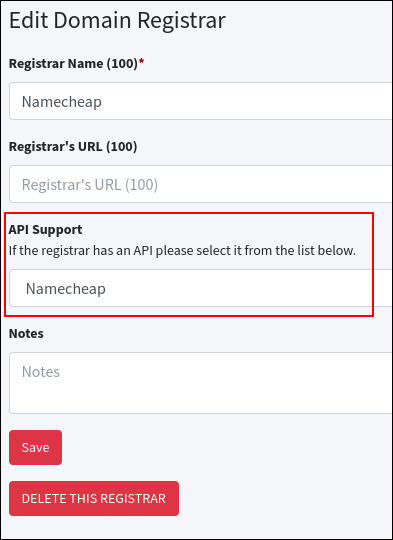
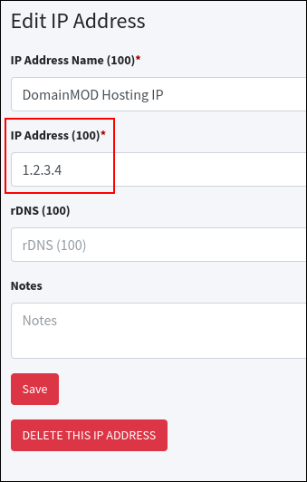
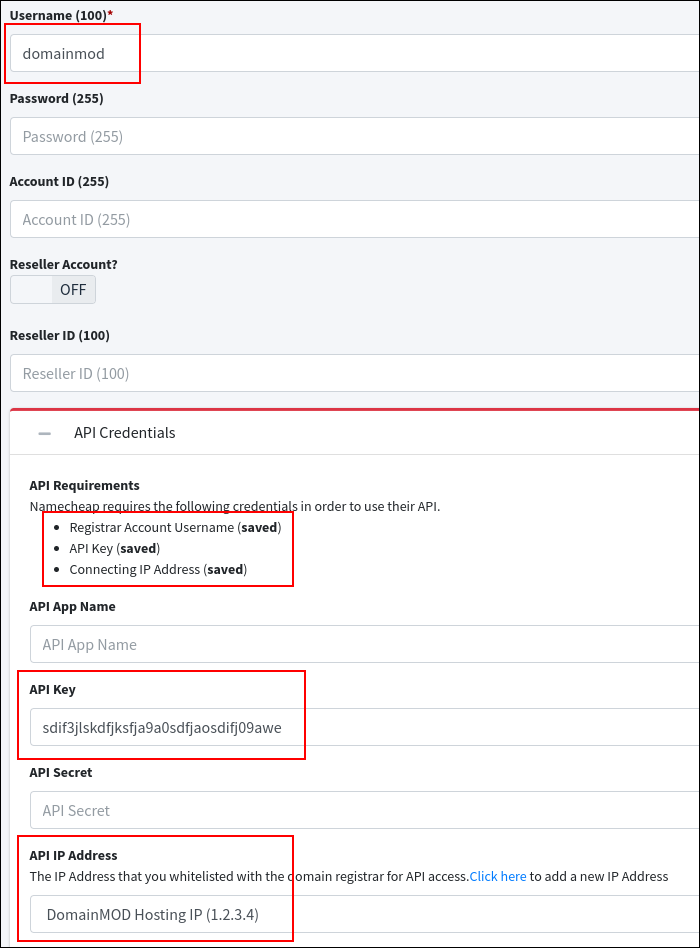
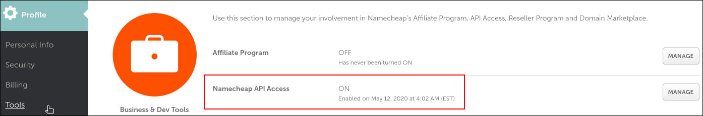
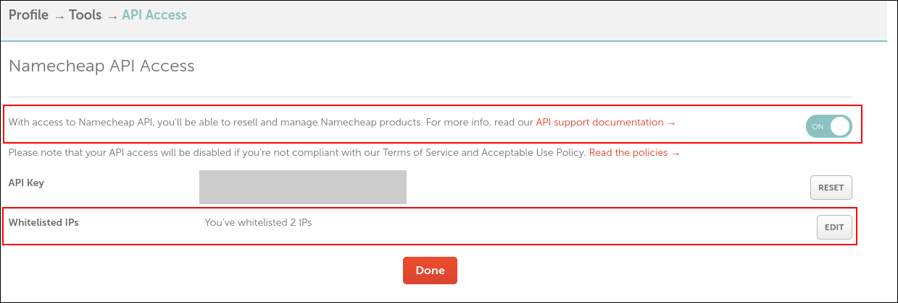
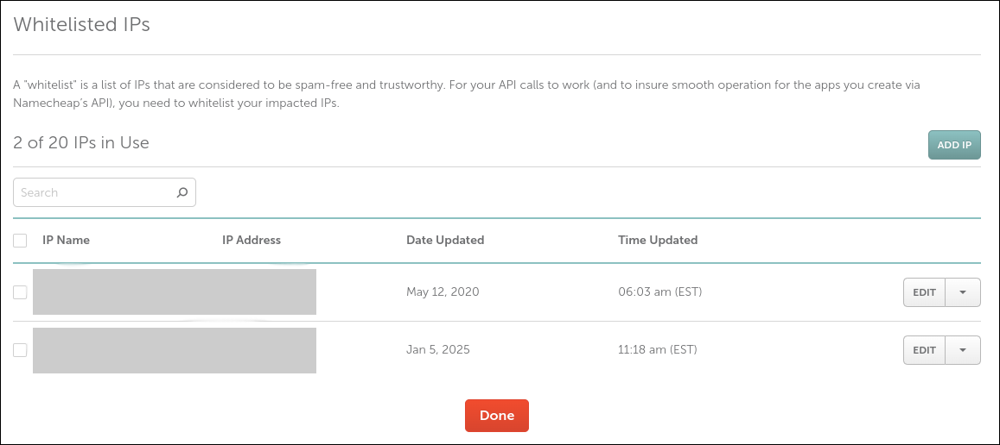

{!_domain-queue-shared.md!}

Supported Registrars
--------------------
The following registrars are currently supported by the Domain Queue:

**Above.com, Cloudflare, DNSimple, DreamHost, Dynadot, eNom, Fabulous, Freenom (Reseller Accounts Only), Gandi, GoDaddy, Hostinger, Internet.bs, Name.com, NameBright, Namecheap, NameSilo, OpenSRS, OVH, Porkbun, ResellerClub, and SiteHost**

If your registrar isn't on this list, you can still use the Domain Queue by [adding your domains without an API](#rdap).

Usage
-----

!!! warning "Requirement"
    In order to use the Domain Queue you must first setup the [cron job](getting-started.md#cron-job) that comes with DomainMOD.

1. Click on **Domains** on the main menu.

2. Click the **Add Domains Automatically** button on the Domains page.

3. Click the **Add Domains Using an API** button.

4. On the dropdown list, choose the registrar account that you would like to import using the Domain Queue.

5. If requested, paste in a list of the domains you want to add to the Domain Queue. This is not always required, as some domain registrars will retrieve the list of domains from your account automatically.

6. Click the **Add Domains** button.

7. You will now be taken to the Domain Queue page, where you can see the status of your domain imports. You can also access the Domain Queue by clicking on **Queue** on the main menu (this menu option is only available when you have domains being processed in the queue).

8. Once all of your imports have completed you can click the **Clear Completed** button in order to clear the queue.

Adding Domains Without an API
-----
If DomainMOD doesn't support your registrar's API, you can paste in a list of your domains and DomainMOD will look up each one using RDAP, the public replacement for WHOIS, or WHOIS itself for domains that RDAP doesn't cover. This fills in each domain's expiry date and DNS servers, and works out which registrar it's at, so you don't need to choose a registrar or enter any API details.

1. Click on **Domains** on the main menu.

2. Click the **Add Domains Automatically** button on the Domains page.

3. Click the **Add Domains Without an API** button.

4. Choose the owner of the domains.

5. Paste in your list of domains, one per line (up to 1,000 at a time).

6. Click the **Add Domains** button, and you'll be taken to the Domain Queue page, where you can follow the progress of your imports.

A registrar that isn't in DomainMOD yet is added for you. Each domain goes into your account at that registrar if you have exactly one, or otherwise into a general account named "RDAP Import", which is created the first time it's needed and used for later imports.

!!! note
    Neither RDAP nor WHOIS includes a domain's WHOIS privacy or auto renewal status, so both are set to No. You can update them afterwards using the [Bulk Updater](bulk-updater.md).

Some country-code registries (such as .de, .nl, and .au) don't publish expiry dates, so those domains can't be looked up this way. WHOIS lookups also need your server to be able to connect to WHOIS servers on port 43, which some web hosts block. If a domain can't be looked up, it fails in the queue with the reason, and you can finish it by hand with [Fix and Import](#fix).

Fixing Failed Domains
-----
If a domain fails in the Domain Queue, you can fix it by hand and import it, rather than adding it again from scratch.

1. On the Domain Queue page, click the edit icon (**Fix and Import**) beside the domain that failed.

2. The Fix and Import page shows the reason the domain failed, and is pre-filled with everything the Domain Queue already knows about it. Fill in the rest of its details, such as the expiry date and registrar account.

3. Click the **Import Domain** button.

The domain is added with the creation type "Queue (Edited Manually)", and the Domain Queue shows it as "Imported (Edited Manually)".

Keeping Domains Up To Date
-----
Once your domains have been added, you can update a single domain at any time using the **Refresh Domain** box on its edit page. See [Refreshing a Domain](faq.md#refresh) for details.

API Notes
-----
This section contains various notes and things to watch out for when using the domain registrar APIs.

<h4>Cloudflare</h4>

A Cloudflare registrar account uses the following fields:

**Username**: your Cloudflare account email address. This is required if you use a Global API Key. If you use an API Token it can be any name for the account.  
**Account ID**: shown on your Cloudflare dashboard.  
**API Key**: either an API Token (recommended) or your Global API Key. An API Token needs read access to Registrar domains, plus Zone Read access so that DomainMOD can retrieve the domains' name servers.

<h4>DreamHost</h4>

DreamHost does not currently allow the WHOIS privacy status of a domain to be retrieved via their API, so all domains added to the Domain Queue from a DreamHost account will have their WHOIS privacy status set to No by default.

<h4>Freenom</h4>

Freenom currently only gives API access to reseller accounts.

<h4>Gandi</h4>

For the API Key, create a personal access token in your Gandi account with read access to your domains. Older Gandi API keys still work.

Gandi does not currently allow the WHOIS privacy status of a domain to be retrieved via their API, so all domains added to the Domain Queue from a Gandi account will have their WHOIS privacy status set to No by default.

<h4>GoDaddy</h4>

For the API Key, create a Personal Access Token at <https://developer.godaddy.com/personal-access-token> with the **domains.domain:read** permission, and leave the API Secret blank. A classic API key and secret also still work until GoDaddy retires them.

When retrieving your list of domains from GoDaddy, the current limit is 1,000 domains. If you have more than this you should export the full list of domains from GoDaddy and paste it into the **Domains to add** field when adding domains via the Domain Queue.

GoDaddy only gives API access to accounts it considers eligible, and has at times limited it to accounts with at least 10 domains or a Discount Domain Club membership. If GoDaddy refuses your account's API requests, domains added to the Domain Queue from it will stay at "Pending".

<h4>Hostinger</h4>

For the API Key, create an API token in your Hostinger dashboard (**Dev tools** -> **API** -> **API tokens**). Hostinger API tokens have full access to your Hostinger account, so consider giving the token an expiry date.

Hostinger does not return the Auto Renewal status when retrieving the details of a domain, so all domains imported via the API will have their Auto Renewal status set to No by default.

<h4>NameSilo</h4>

NameSilo's domains have 6 possible statuses: Active, Expired (grace period), Expired (restore period), Expired (pending delete), Inactive, and Pending Outbound Transfer

When retrieving your list of domains via the API, **Inactive** domains are not returned.

When retrieving the details of a specific domain via the API, **Inactive** and **Expired (pending delete)** domains will not return any data.

<h4>OVH</h4>

An OVH registrar account uses the following fields:

**API Key**: your OVH Application Key.  
**API Secret**: your Application Secret.  
**Account ID**: your Consumer Key.

Create all three on the key page for your OVH region ([Europe](https://eu.api.ovh.com/createToken/), [Canada](https://ca.api.ovh.com/createToken/), or [US](https://api.us.ovhcloud.com/createToken/)), with two read-only rights: **GET /domain** and **GET /domain/\***.

<h4>Porkbun</h4>

When retrieving your list of domains from Porkbun, the current limit is 1,000 domains. If you have more than this you should export the full list of domains from Porkbun and paste it into the **Domains to add** field when adding domains via the Domain Queue.

<h4>ResellerClub</h4>

ResellerClub does not allow users to retrieve a list of their domains via the API, nor do they return the Auto Renewal status when retrieving the details of a domain. All domains imported via the API will have their Auto Renewal status set to No by default.

<h4>SiteHost</h4>

A SiteHost registrar account uses the following fields:

**Account ID**: your SiteHost Account ID, which is shown on your SiteHost invoices.  
**API Key**: a key from the SiteHost Control Panel (in the API module) with access to **Domains (SRS)**.

SiteHost prices are in NZD.

Example
-----
Below is an example of how to use the Domain Queue to import the domains from a Namecheap account:

Create a **Domain Registrar** asset, ensuring that you've selected **Namecheap** on the **API Support** dropdown list.

 Create an **IP Address** asset, ensuring that you enter the public IP address of the server that DomainMOD is running on.

 Create a **Domain Registrar Account** asset, ensuring that you've entered your account username and API Key, and that you've selected the IP address that you created in the previous step.

 On your Namecheap account, go to **Profile** -> **Tools** to view the status of your API access. Next, click on **Manage** to view your whitelisted IP addresses.

 If your API Access was not enabled in the previous step, you can enable it here.

To the right of the **Whitelisted IPs** section, click on **Edit** to view your whitelisted IP addresses.

 On the **Whitelisted IPs** page, ensure that your public IP address is listed.

And that's it, your Namecheap API connection should now be set up!

With your API connection up and running, it's time to [import your domains using the Domain Queue](#usage).
